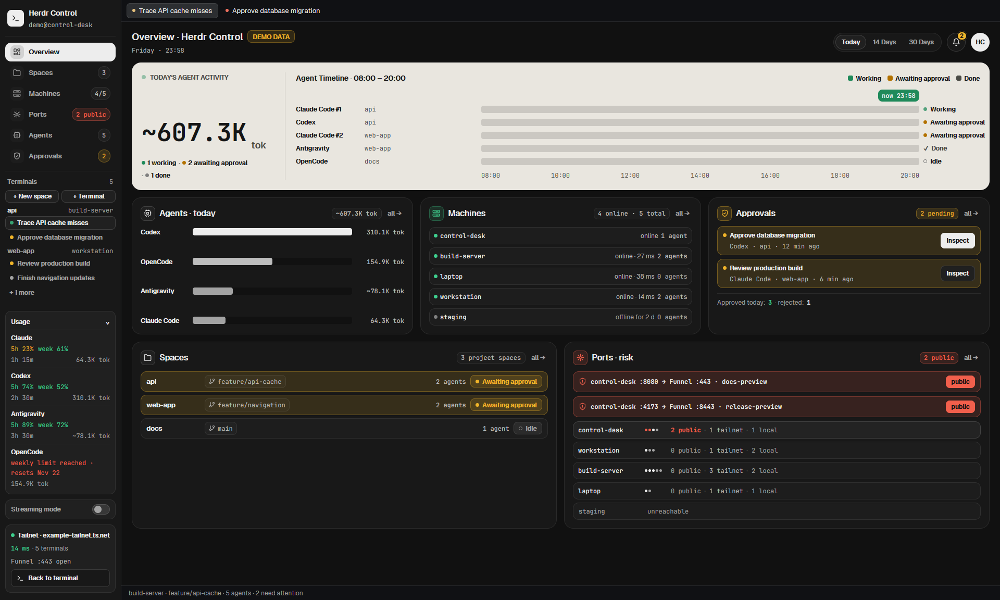
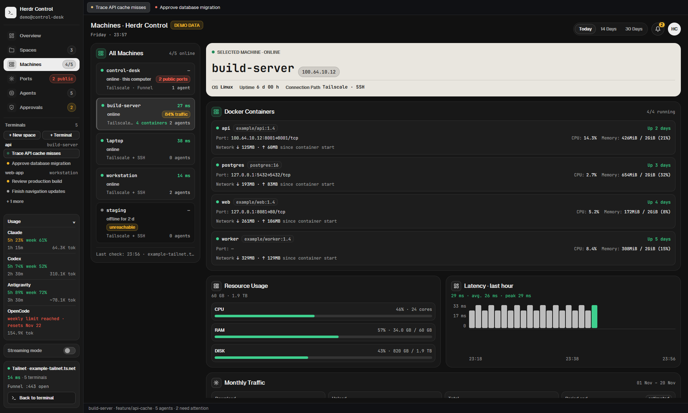
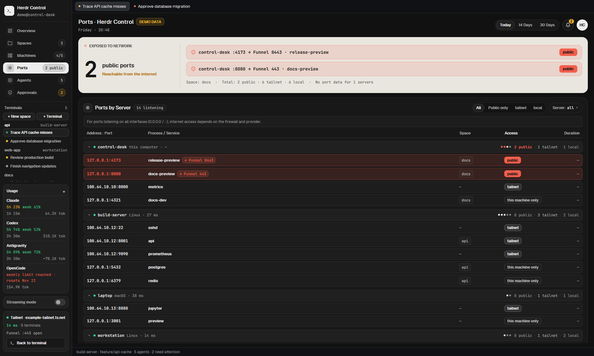
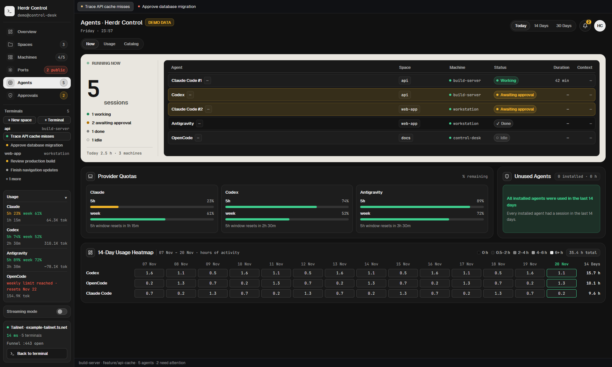
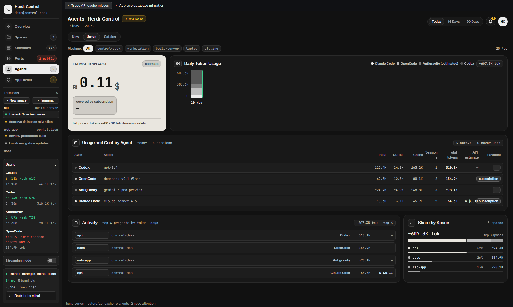
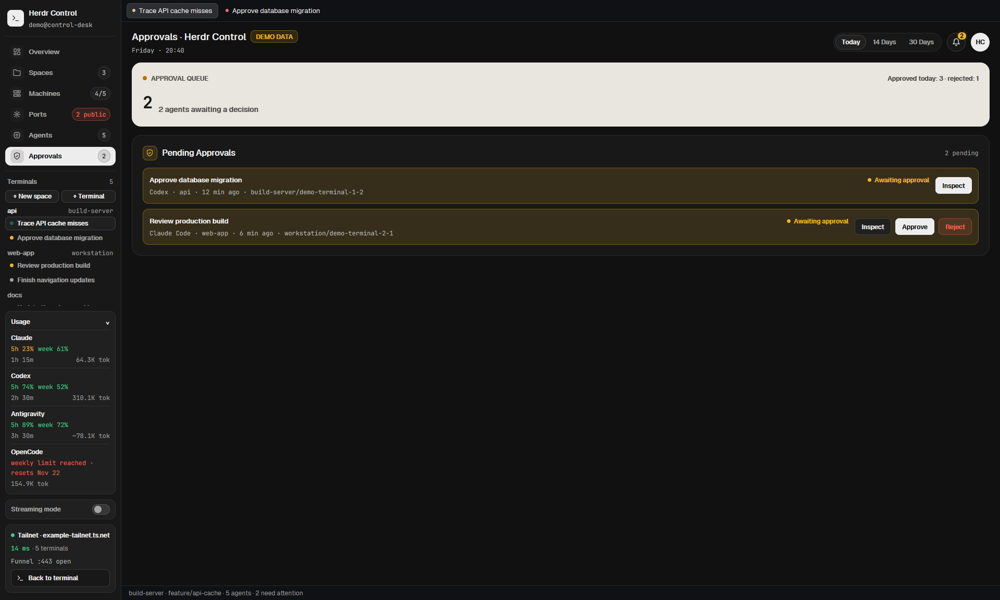
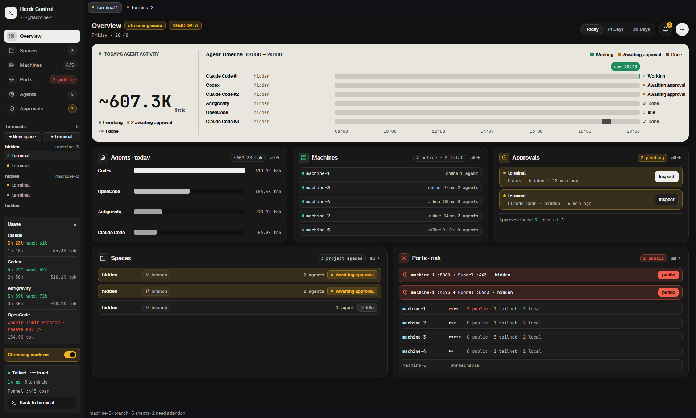
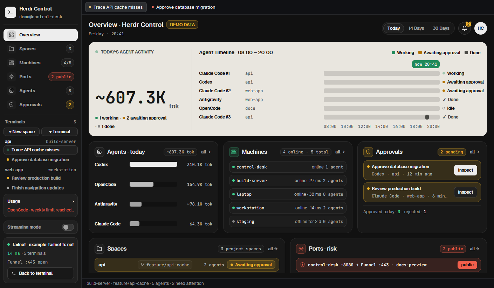

<h1 align="center">Herdr Control</h1>

<p align="center">A control room for Herdr with agents, limits, machines, ports, and approvals in one sidebar.</p>

<p align="center">
  <a href="LICENSE"></a>
  <a href="#requirements"></a>
  <a href="layouts/herdr-control.json"></a>
</p>

<p align="center">
  <a href="docs/screenshots/overview.png"></a>
  <br><em>(demo data)</em>
</p>

## Install with your agent

**Option A — Layout**

> Read `~/.config/herdr-app/AGENTS.md`, then add this layout: https://github.com/hasan-furkan/herdr-control. Follow Option A in its `RECIPE.md`.

**Option B — Mod only**

> Read `~/.config/herdr-app/AGENTS.md`, then add the Herdr Control mod to my current layout: https://github.com/hasan-furkan/herdr-control. Follow Option B in its `RECIPE.md`.

See [RECIPE.md](RECIPE.md) for install, update, and uninstall steps.

## Why

- See agent activity, quotas, approvals, machines, and open ports in one place.
- Keep agent usage and quota data on the machine where it's collected. The mod sends no telemetry.
- Use streaming mode to mask sensitive details when sharing your screen.

## Screens

| | |
| --- | --- |
| **Machines**<br>[](docs/screenshots/machines.png) | **Ports**<br>[](docs/screenshots/ports.png) |
| **Agents · Now**<br>[](docs/screenshots/agents-now.png) | **Agents · Usage and Cost**<br>[](docs/screenshots/agents-usage.png) |
| **Approvals**<br>[](docs/screenshots/approvals.png) | **Streaming mode**<br>[](docs/screenshots/streaming-mode.png) |
| **Compact sidebar**<br>[](docs/screenshots/sidebar-short.png) | |

- **Overview** shows today's agent activity and a summary of machines, spaces, pending approvals, and port exposure.
- **Spaces** shows each project's branch, terminals, agents, ports, recent commits, and usage activity when available.
- **Machines** shows connection status, latency, CPU, memory, disk, monthly traffic, open ports, and Docker containers where available.
- **Ports** groups listening ports by machine, highlights public exposure through Tailscale Funnel, and filters ports by access level.
- **Agents · Now** shows agent status, provider quotas, unused tools, and a 14-day activity heatmap.
- **Agents · Usage and Cost** shows daily tokens, model and provider breakdowns, project usage, and estimated API costs.
- **Agents · Catalog** shows configured agents, detected installations, and optional version checks.
- **Approvals** lets you inspect blocked agents. Claude Code approvals can be approved or rejected after an inline confirmation.
- **Sidebar Usage** shows available quota windows and today's tokens. The layout also offers a terminal side panel with the active space's agents, ports, and approvals.
- **Tools and Phrasebook** provide shortcuts to Herdr settings and the command palette, plus a read-only view of a Markdown phrasebook.

## Requirements

- Herdr desktop with the JavaScript mod API (`herdr`, `gpui-kit`, and `gpui-base`), custom layouts, and remote `exec` support for peer collection. The bundled tab bar was cloned from Herdr's built-in `tabs` version `0.1.16`. The manifest records the built-in mod version and does not establish a minimum Herdr desktop version.
- Python 3.9+ on every machine that runs the collector, including Herdr peers. The collector uses the Python standard library and looks for `python3`, `py -3`, or `python`.
- Node.js is only needed to run the JavaScript tests. Tailscale, Docker, and `vnstat` supply additional data where available.

## Install

### Option A: Layout

Run the commands from this project's root for a fresh installation. The links point to this checkout, so keep it in place after installation. If the layout name already exists, copy the JSON to an unused filename and use that name when switching layouts. See [RECIPE.md](RECIPE.md) if any of the four mod folders are already installed.

The standard install also installs the Claude limits plugin for the current user when the `claude` command is available. It adds one isolated plugin and leaves the user's status line, hooks, and other plugins intact. The plugin writes the live limits snapshot to `~/.claude/limits-claude.json`; see [RECIPE.md](RECIPE.md#claude-code-limits-plugin) for install, update, and removal commands.

#### Windows (PowerShell)

Create directory junctions with `New-Item -ItemType Junction`. Command Prompt's `mklink /J` creates the same kind of link.

```powershell
$project = (Get-Location).Path
$config = Join-Path $HOME '.config/herdr-app'
$mods = Join-Path $config 'mods'
$layouts = Join-Path $config 'layouts'
$layoutName = 'herdr-control'
New-Item -ItemType Directory -Force -Path $mods, $layouts | Out-Null
if (Test-Path -LiteralPath (Join-Path $layouts "$layoutName.json")) {
    throw 'Choose an unused layout name in $layoutName.'
}
$modNames = 'herdr-control', 'herdr-control-tabs', 'herdr-control-tools', 'herdr-control-phrases'
foreach ($name in $modNames) {
    $target = Join-Path $mods $name
    if (Get-Item -Force -LiteralPath $target -ErrorAction SilentlyContinue) {
        throw "Already installed: $target"
    }
}

foreach ($name in $modNames) {
    New-Item -ItemType Junction -Path (Join-Path $mods $name) -Target (Join-Path $project "mods/$name") -ErrorAction Stop
}
Copy-Item -LiteralPath (Join-Path $project 'layouts/herdr-control.json') -Destination (Join-Path $layouts "$layoutName.json")
```

#### macOS and Linux

```sh
config="$HOME/.config/herdr-app"
layout_name=herdr-control
(
    set -e
    mkdir -p "$config/mods" "$config/layouts"
    layout_path="$config/layouts/$layout_name.json"
    if [ -e "$layout_path" ] || [ -L "$layout_path" ]; then
        echo "Choose an unused layout name in layout_name." >&2
        exit 1
    fi
    for name in herdr-control herdr-control-tabs herdr-control-tools herdr-control-phrases; do
        target="$config/mods/$name"
        if [ -e "$target" ] || [ -L "$target" ]; then
            echo "Already installed: $target" >&2
            exit 1
        fi
    done
    for name in herdr-control herdr-control-tabs herdr-control-tools herdr-control-phrases; do
        ln -s "$PWD/mods/$name" "$config/mods/$name"
    done
    cp -n layouts/herdr-control.json "$layout_path"
)
```

#### Switch layouts

With Herdr running, cycle to `herdr-control` with Ctrl+Shift+L, or run the following in a POSIX shell or PowerShell 7.3+ with standard native argument passing.

```sh
herdr-app do layout.switch '{"name":"herdr-control"}'
```

In Windows Command Prompt, use `herdr-app do layout.switch "{\"name\":\"herdr-control\"}"`. The layout opens on Overview. Use **Back to terminal** or click a terminal tab to return to the terminal view.

### Option B: Mod only

1. Copy only `mods/herdr-control` into `~/.config/herdr-app/mods/` for a fresh install.
2. Back up your current personal layout JSON. Add [the panel block](layouts/snippets/herdr-control-panel.json) to an existing `row`'s `children`, to the left or right of your terminal area. If you already have a `herdr-control` block, update its `content.props.part` to `panel` and keep its ID and placement. Duplicate a shipped layout in Herdr before editing it.
3. To show or hide the panel, run `herdr-app do layout.toggle --id herdr-control-panel`, using your node's ID if it differs. The recipe includes an optional keyboard shortcut.

To open the dashboard on demand in a tab, install the mod folder and run the command below. This also works with a shipped layout.

```sh
herdr-app do tab.new --mod herdr-control --name "Herdr Control"
```

## Configuration

- **Monthly traffic** — Set `TRAFFIC_LIMITS` in `mods/herdr-control/limits.js`, keyed by the machine name shown in Herdr or Tailscale. Set `monthly_tb`, `count` (`"total"` for download plus upload, `"out"` for upload only), and `billing_day` to match your billing period.
- **Agent catalog** — Add `mods/herdr-control/catalog.local.js` to customize the agent roster. See the [local catalog guide](docs/local-catalog.md).
- **Phrasebook** — Set `HERDR_CONTROL_PHRASES_FILE` in the Herdr app's environment to the path of a readable Markdown file.
- **OpenCode Go quota** — The collector finds a Go API key in OpenCode's local credential store, or uses `OPENCODE_GO_API_KEY` when set. See [OpenCode Go quota](#opencode-go-quota) for the lookup order, the one host that receives the key, and how to turn the local lookup off.
- **Antigravity quota probe** — When the optional quota snapshot is missing or stale, the collector can run `agy -p /usage --output-format json` if `agy` is on `PATH`. On Windows this requires `HERDR_CONTROL_AGY_PROBE=1` in the app's environment. The probe has a cooldown of 3600 s on Windows and 300 s on macOS/Linux, and re-probes on new agy activity every 60 s at most.
- **Optional quota snapshots** — `~/.claude/limits-claude.json` supplies Claude Code quotas for up to six hours and `~/.claude/limits.json` supplies Antigravity's Gemini quotas for up to one hour. An external tool or user-managed script must write these files. Herdr Control only reads them, and this project ships no snapshot writer.

### OpenCode Go quota

The collector looks for an OpenCode Go API key in this order:

1. `OPENCODE_GO_API_KEY` in the Herdr app's environment.
2. OpenCode's local credential store in its SQLite database. The collector opens the database read-only, inspects the schema, and reads only the `opencode-go` row when its stored type is an API key. OAuth and OpenCode Console tokens and other provider rows are ignored. The path comes from `opencode debug paths db`; it usually follows `XDG_DATA_HOME`, the release-channel database name, or `OPENCODE_DB`, and defaults to `~/.local/share/opencode/opencode.db`.
3. The legacy `auth.json` in the same data directory, entry `opencode-go` with `{"type":"api","key":...}`, only when the credential store has no Go row.

The key stays in memory for the request. It is sent only to `https://opencode.ai/inference/go/v1/usage` with a 5 s timeout; the collector makes at most one request per 60 s and caches the normalized response for 60 s without the key. The key is never written to the cache, logs, errors, notes, or dashboard output. `--remote` runs never call the endpoint.

Set `HERDR_CONTROL_OPENCODE_KEY_LOOKUP=0` in the app's environment to skip the local store and legacy `auth.json` lookup. `OPENCODE_GO_API_KEY` still wins when it is set. If no key is found, no request is made and the OpenCode row keeps the spend estimate.

If you do not have a stored Go key, connect once: run `/connect`, choose **OpenCode Go**, and paste the key. From the CLI, run `opencode auth login opencode-go --method key`.

## What data it reads

The collector reads these agent sources on the machine running the full collection profile. Paths are relative to that user's home directory on all supported platforms.

| Agent tool | Local paths | Data used |
| --- | --- | --- |
| Claude Code | `~/.claude/projects/**/*.jsonl`, `~/.claude/limits-claude.json` | Token counts and model, session, time, and project metadata, plus the optional quota snapshot |
| OpenCode | `~/.local/share/opencode/opencode.db`, `~/.local/share/opencode/auth.json`, `~/.local/share/opencode/log/opencode.log`; optional `OPENCODE_GO_API_KEY` | Message token counts and associated metadata from SQLite, the stored Go API key when present, recent OpenCode Go quota errors and reset times from the log, and live Go quota percentages from opencode.ai when a key is found |
| Codex | `~/.codex/sessions/**/*.jsonl` | Token-count events and recent rate-limit records |
| Antigravity | `~/.gemini/antigravity-cli/conversations/*.db`, `~/.gemini/antigravity-cli/cache/last_conversations.json`, `~/.claude/limits.json` | Inferred token and model metadata, recent conversation and workspace associations, and the optional Gemini quota snapshot |

Agent logs, databases, and quota snapshots are read-only inputs. The collector keeps its own caches in `%LOCALAPPDATA%\herdr-control\` on Windows and `~/.cache/herdr-control/` on macOS and Linux. Herdr supplies live spaces, terminals, agents, and machine state. The dashboard also reads host metrics, listening ports, and available Tailscale, Docker, and network data.

Agent usage and quota files stay on the machine, and the mod has no telemetry upload service. With `OPENCODE_GO_API_KEY` or a Go key from OpenCode's local store, the collector makes an HTTPS quota request to opencode.ai; the key is read locally, sent only to that host, and is not written to caches, logs, errors, notes, or output. Herdr runs the collector on ready peer machines with `--remote` and receives only system, ports, network, and Docker data, plus collection timestamps and diagnostics. This profile skips agent usage and quota collection, including the OpenCode Go request. Tailscale peer pings, optional `agy` CLI calls, and the OpenCode quota request can generate outbound traffic.

## Streaming mode

Turn on **Streaming mode** in the sidebar to mask machine and tailnet names, network addresses, usernames, project and space names, paths, terminal and agent titles, command lines, Git branches and commit details, command output and errors, process names, deployment-specific catalog details, and raw Docker labels in the mod's dashboard. Port numbers and dashboard counts can remain visible.

Herdr's native terminal contents, pane headers, and other built-in panels are outside the mask. Share a Herdr Control dashboard screen when you want the masked view.

## Demo data

While Herdr Control is visible, run `herdr-app do herdr-control.toggle-demo` or open the Tools overlay and select **Herdr Control: Toggle demo data**. The top bar displays **DEMO DATA**. The dashboard, tab bar, status bar, and phrasebook use synthetic data and pause new collector runs and process-backed actions. Toggle again to resume live data.

## Estimated values

Antigravity token counts and model IDs are inferred from undocumented conversation metadata. The dashboard marks affected token figures with `~`. API cost estimates use the token counts and model prices in `mods/herdr-control/prices.js`. These figures represent API list-price estimates. Actual bills and subscription charges can differ, and the dashboard leaves prices blank for unlisted models. The OpenCode row's Go figure is an estimate used when live quota windows are unavailable: OpenCode-provider usage since day 24 of the month at 0.6 × list price, bounded by the 31-day usage window and marked `≥` when it can only be a lower bound. With a Go API key from `OPENCODE_GO_API_KEY` or OpenCode's local store, the row shows the live Go 5-hour, weekly, and monthly percentages from opencode.ai instead, and the estimate moves to the hover/narrow details as a secondary `est.` value.

## Security notes

Herdr mods are not sandboxed. They execute with the app user's permissions, including access to local files and commands. Read the code before installing. The [Security review](docs/security-review-p5.md) records findings from an earlier snapshot.

## Development

From the project root, run the JavaScript tests and check each mod against Herdr.

```sh
node --test mods/herdr-control/data.test.mjs
herdr-app check mods/herdr-control
herdr-app check mods/herdr-control-tabs
herdr-app check mods/herdr-control-tools
herdr-app check mods/herdr-control-phrases
```

Run the Python tests from `mods/herdr-control/collector`.

```sh
python -m unittest
```

After changing the collector, regenerate `mods/herdr-control/collector/packed.js` from the project root.

```sh
python scripts/pack-collector.py
```

Use `python3` or `py -3` if that is how you invoke Python on your system. The general mod validation command is `herdr-app check <folder>`.

## Disclaimer

Herdr Control is an unofficial community project and is not affiliated with Herdr.

## License

MIT. See [LICENSE](LICENSE).

Herdr's bundled tab bar code is used under the [Apache 2.0 license](docs/LICENSE-APACHE). See [the original tabs mod](https://github.com/herdrdev/herdr-app/tree/v0.1.16/defaults/mods/tabs).
